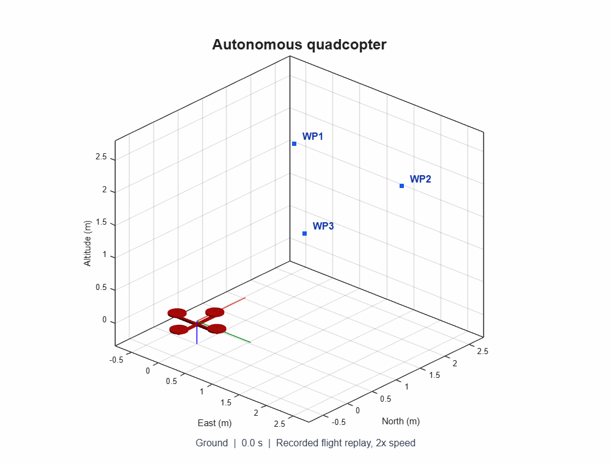
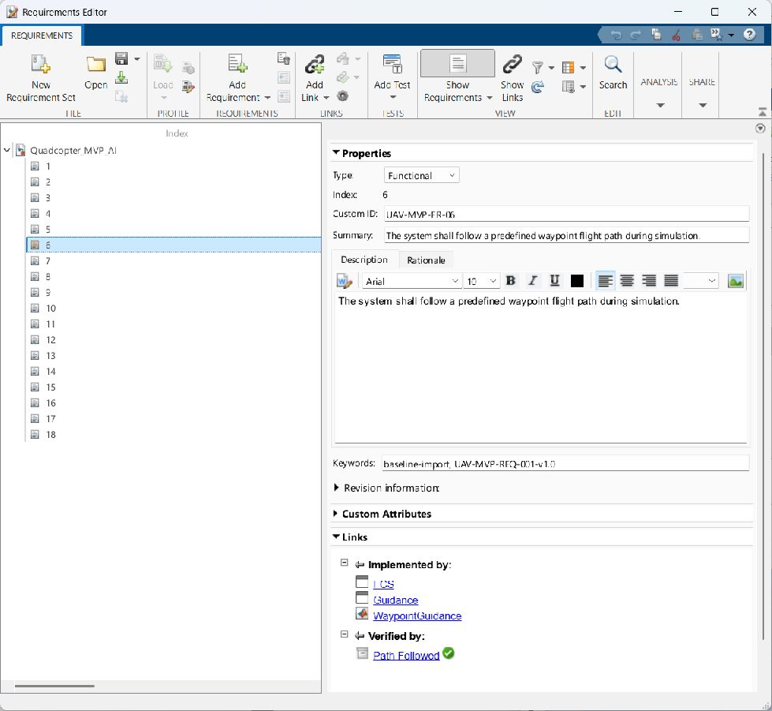
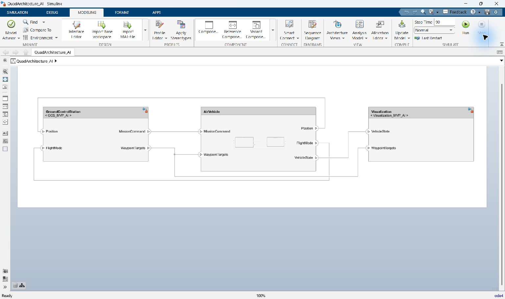
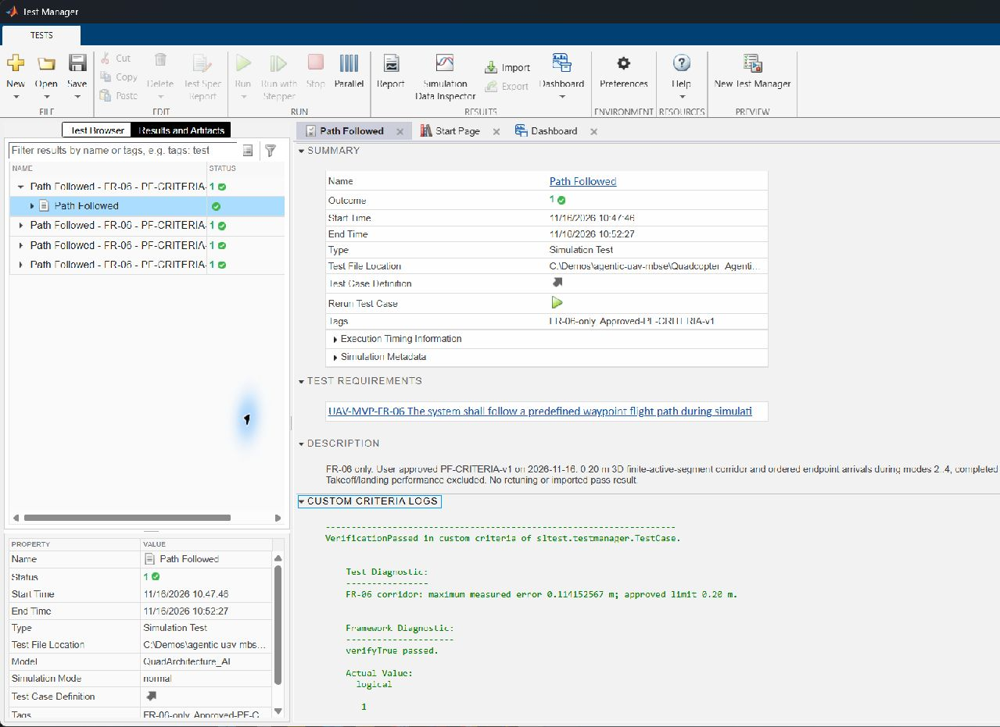
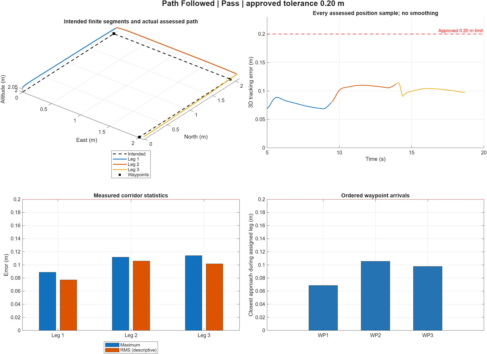

# Agentic Quadcopter MBSE Demo

An AE demonstration of an agent-assisted Model-Based Systems Engineering workflow: **requirements → architecture → executable model → 3D simulation → verification**.

The quadcopter performs autonomous takeoff, visits three waypoints, and lands using PID-based control and a low-fidelity vehicle model.



## Prerequisites

Validated with **MATLAB R2026b Update 1**, Simulink, System Composer, Requirements Toolbox, Stateflow, and UAV Toolbox. **Simulink Test** is additionally required for stage 04.

To extend or recreate the demo with an agent, connect it to the MATLAB MCP server and provide these skills:

- `robotics-and-autonomous-systems`
- `simulink-simulation`
- `verification-validation-and-test`
- `model-based-system-engineering`
- `model-based-design-core`

Agent skills are not needed to run the saved models.

## Start here

1. Clone the repository and open MATLAB in its root folder.
2. Open the guided Live Script:

   ```matlab
   open('Quadcopter_Demo_Walkthrough.m')
   ```

3. Update `projectRoot` in its first section, then use **Run Section** to review each stage.

The walkthrough opens models, requirements, source code, saved results, plots, and the GIF without rerunning simulations or tests.

## Stages

Each folder under `Quadcopter_Agentic_Demo/` is a self-contained checkpoint.

| Stage | Contents | Run from the stage folder |
|---|---|---|
| `01_Requirements_Architecture` | Requirements, architecture, interfaces, and traceability | Open `QuadArchitecture_AI.slx` and `Quadcopter_MVP_AI.slreqx` |
| `02_Executable_Model` | Mission logic, guidance, PID control, and vehicle dynamics | `[out, report] = run_stage02_smoke;` |
| `03_3D_Flight_Simulation` | Native UAV Animation and trajectory plots | `[out, report] = run_stage03_flight;` |
| `04_Path_Followed_Verification` | Approved Path Followed test, links, and saved results | `run_stage04_verification` |

Close models from other stages before switching: the checkpoints reuse model names. **Copy a stage before rerunning or modifying it**; run helpers overwrite local evidence files.

See each stage's `STAGE_README.md` for details. To reuse the agent workflow, follow [UAV Webinar Demo Prompts.md](UAV%20Webinar%20Demo%20Prompts.md). The [Markdown requirements baseline](Quadcopter_MVP_Requirements_v1.md) defines the scope.

## Stage snapshots

| Requirements and traceability | Integrated executable model |
|---|---|
| [](graphics/requirements_traceability.png) | [](graphics/executable_model.png) |

| Saved Simulink Test result | Measured path-following evidence |
|---|---|
| [](graphics/verification_results.png) | [](graphics/path_following_evidence.png) |

The requirements and model screenshots show stage 04's local copies. The original [stage-01 architecture diagram](graphics/architecture.png) is also available. Click any image for its full-size view.

## Recorded result and limits

The saved mission completed in **28.16 simulated seconds**. The single formal test verifies **UAV-MVP-FR-06** against approved criteria: every sampled cruise position within **0.20 m** of its active finite 3D path segment, ordered waypoint arrivals within **0.20 m**, and path completion within **90 seconds**. Recorded maximum tracking error: **0.1142 m — Pass**.

Takeoff and landing performance are excluded from that criterion. This simulation result does not establish flight safety, hardware readiness, physical touchdown performance, or overall UAV compliance.

## Reference

Based on the architecture and verification workflow in the [MathWorks quadcopter example](https://www.mathworks.com/help/systemcomposer/ug/develop-verify-quadcopter-system-architecture.html).
